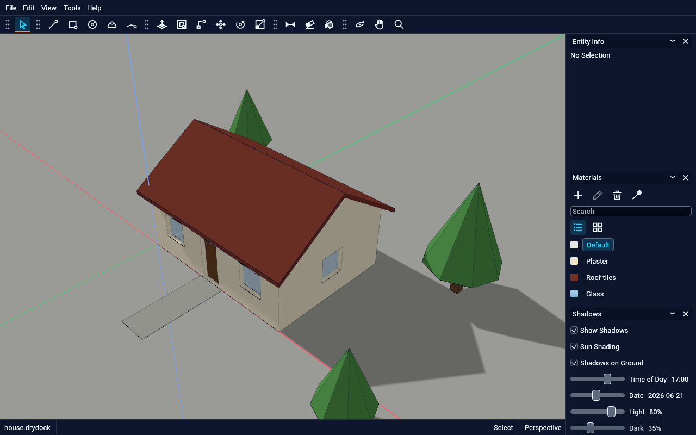

# Drydock

Subspace Drydock is a free desktop 3D modeler for buildings, rooms, furniture, products and
anything else you can draw. You sketch flat shapes and pull them into solids, much like drawing on
paper with depth, and it is especially good at preparing models for 3D printing. It runs on Windows
and Linux and is written in Rust.


The model in the screenshots is [docs/examples/house.drydock](docs/examples/house.drydock); open it with File > Open.

## What it does

- **Drawing:** lines, rectangles, circles and arcs (center or three-point) with inference snapping
  and typed dimensions.
- **Modeling:** Extrude (push/pull), Move, Rotate, Scale, Flip, Follow Me and Offset; groups and
  reusable components; tags to show and hide parts of a model.
- **Materials:** colors and textures, painted onto faces.
- **Sun and shadows:** set a location, date and time and see the shadows move.
- **3D printing:** check that a model is a printable solid, repair it, and export STL or 3MF.
- **Files:** its own `.drydock` format ([docs/format.md](docs/format.md)); imports COLLADA (DAE),
  STL and 3MF.
- **Windows updates:** the Windows build finds, verifies and installs new releases itself.



A user guide ships with the program (Help > User Guide, F1); its source is in
[docs/guide](docs/guide/welcome.md).

## Status

Drydock is beta software. The features above work and are tested, but expect rough edges, and keep
copies of models you care about. Bug reports are welcome (see [CONTRIBUTING.md](CONTRIBUTING.md)).

## Download

Windows installers are on the releases page. Each release lists SHA-256 checksums;
[app/packaging/INSTALL.md](app/packaging/INSTALL.md) explains how to check a download and what to
expect from Windows SmartScreen while the installer is unsigned. On Linux, build from source.

## Build from source

You need the Rust toolchain (rustup installs the version pinned in `app/rust-toolchain.toml`) and,
on Linux, the development packages for X11, Wayland and fonts. On Debian or Ubuntu:

```sh
sudo apt install build-essential pkg-config cmake libssl-dev libx11-dev libxcursor-dev \
  libxrandr-dev libxi-dev libxkbcommon-dev libwayland-dev libfontconfig-dev libudev-dev
```

Then:

```sh
cd app
cargo run --release -p drydock
```

Drydock draws with wgpu, so it needs a working Vulkan or DirectX 12 driver. On Linux,
[docs/guide/linux.md](docs/guide/linux.md) explains the desktop entry and icons it creates.

## How it was built

Drydock was built mostly by AI agents: an orchestrating agent wrote specifications and acceptance
tests, and worker agents implemented them, with every change checked by formatting, lint, tests, a
license gate and a snippet scan before it merged. A person at Subspace Systems set the direction,
tried each milestone in the real program and accepted it. The commit history shows the whole
process.

Drydock is written from scratch and contains no code or artwork from other 3D modelers.

## Maintenance

I review issues and PRs and release updates; response times vary.

## License

Drydock is free software: you can redistribute it and/or modify it under the terms of the GNU
General Public License, version 3 or (at your option) any later version. See [LICENSE](LICENSE).
Third-party material is listed in [app/NOTICE](app/NOTICE).

Contributions need a signed [Contributor License Agreement](CLA.md); see
[CONTRIBUTING.md](CONTRIBUTING.md). Security problems: [SECURITY.md](SECURITY.md). The Drydock
name and logo are trademarks of Subspace Systems: [TRADEMARKS.md](TRADEMARKS.md).
